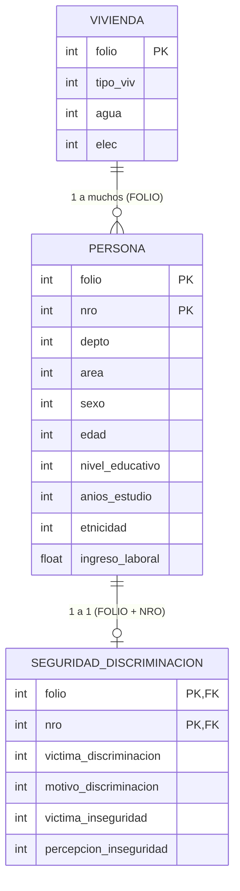

# Informe Metodológico y Técnico: Minería de Datos y Analítica Predictiva sobre Microdatos de la Encuesta de Hogares (INE Bolivia)

**Metodología Guía:** Cross-Industry Standard Process for Data Mining (CRISP-DM)  
**Caso de Estudio:** CASO 3: Discriminación, Seguridad Ciudadana y Factores Sociodemográficos  
**Autor:** Senior Data Scientist & Machine Learning Engineer  
**Fecha de Publicación:** Noviembre 2026  

---

## Resumen Ejecutivo

El presente proyecto implementa una solución integral de analítica predictiva y minería de datos visual aplicada a los microdatos de la **Encuesta de Hogares del Instituto Nacional de Estadística (INE) del Estado Plurinacional de Bolivia**. El objetivo central radica en modelar, cuantificar e interpretar los determinantes sociodemográficos, económicos y geográficos vinculados a la percepción y victimización de hechos de discriminación y seguridad ciudadana (Caso 3).

La arquitectura tecnológica articula un procesamiento relacional columnar en memoria con **DuckDB**, perfiles exploratorios automatizados de última generación (**Sweetviz** y **ydata-profiling**), visualización multivariada orientada a la reducción de sobretrazado (**Seaborn** y **Plotly**), y modelos de aprendizaje supervisado en ensamble (**Random Forest** y **XGBoost / HistGradientBoosting**) complementados con interpretabilidad agnóstica global y local mediante **SHAP (SHapley Additive exPlanations)**.

---

## 1. Fase 1: Comprensión del Negocio (Business Understanding)

### 1.1 Contexto Institucional y Motivación
La Encuesta de Hogares (EH), ejecutada anualmente por el INE de Bolivia, constituye el instrumento estadístico oficial de mayor envergadura para monitorear las condiciones de vida, el empleo, los ingresos, el bienestar social y la equidad en el país. El estudio de la discriminación y la seguridad ciudadana se alinea directamente con los **Objetivos de Desarrollo Sostenible (ODS)**:
- **ODS 10 (Reducción de las Desigualdades):** Garantizar la igualdad de oportunidades y reducir la exclusión por motivos de género, pertenencia étnica o condición socioeconómica.
- **ODS 16 (Paz, Justicia e Instituciones Sólidas):** Reducir significativamente todas las formas de violencia y la percepción de vulnerabilidad en el espacio público y privado.

### 1.2 Formulación del Problema y Preguntas de Investigación
1. ¿En qué medida variables como la autoidentificación indígena campesina, el género, el área geográfica (urbana/rural) y el nivel educativo influyen en la probabilidad de que una persona reporte haber sido víctima de discriminación?
2. ¿Existe una brecha sistemática en el acceso a ingresos laborales y oportunidades económicas entre diferentes grupos poblacionales que agrave la vulnerabilidad ciudadana?
3. ¿Puede un modelo de clasificación supervisado predecir de forma confiable la pertenencia a perfiles vulnerables a la discriminación o inseguridad, permitiendo focalizar intervenciones preventivas?

### 1.3 Criterios de Éxito
- **Técnicos:** Lograr un modelo predictivo con métrica $ROC\text{-}AUC \ge 0.70$ y una adecuada sensibilidad ($Recall$) sobre la clase minoritaria, garantizando balance entre falsos positivos y falsos negativos.
- **Negocio / Políticas Públicas:** Generar insights explicables mediante valores SHAP que respalden decisiones informadas para ministerios, gobiernos autónomos departamentales y organismos de cooperación internacional.

---

## 2. Fase 2: Comprensión de los Datos (Data Understanding)

### 2.1 Naturaleza y Estructura de los Microdatos
Los microdatos del INE se distribuyen en archivos planos y paquetes estadísticos, siendo el formato SPSS (`.sav`) el estándar de distribución debido a su capacidad para preservar etiquetas descriptivas tanto a nivel de variable (`variable_labels`) como a nivel de códigos de respuesta (`value_labels`).

La estructura relacional se organiza en entidades clave:
- **Nivel Hogar (`FOLIO`):** Características de la vivienda, materialidad, equipamiento del hogar y servicios básicos.
- **Nivel Persona (`FOLIO` + `NRO`):** Demografía, educación, salud, empleo, ingresos y módulos específicos (discriminación, percepción de seguridad ciudadana).

### 2.2 Variables Analíticas Clave
| Variable | Mnemónico INE | Tipo | Descripción y Rango de Valores |
|---|---|---|---|
| Departamento | `DEPTO` | Categórica Nominal | 1=Chuquisaca, 2=La Paz, 3=Cochabamba, 4=Oruro, 5=Potosí, 6=Tarija, 7=Santa Cruz, 8=Beni, 9=Pando |
| Área Geográfica | `AREA` | Categórica Binaria | 1=Urbana, 2=Rural |
| Sexo | `s02a_02` / `sexo` | Categórica Binaria | 1=Hombre, 2=Mujer |
| Edad | `s02a_03` / `edad` | Numérica Discreta | Años cumplidos (12 a 98) |
| Nivel Educativo | `nivel_ed` | Categórica Ordinal | 1=Sin instrucción, 2=Primaria, 3=Secundaria, 4=Superior |
| Autoidentificación Étnica | `pebi` / `etnicidad`| Categórica Nominal | 1=Quechua, 2=Aymara, 3=Guaraní, 4=Otro, 5=No indígena |
| Ingreso Laboral Mensual | `YLAB` / `YPRILAB` | Numérica Continua | Ingreso en Bolivianos (Bs.) |
| Víctima de Discriminación | `s08a_01` / Target | Binaria (Objetivo) | 1=Sí fue víctima en los últimos 12 meses, 0=No fue víctima |

---

## 3. Fase 3: Preparación de los Datos (Data Preparation)

### 3.1 Ingesta Relacional con DuckDB
El módulo `src/ingesta.py` resuelve los cuellos de botella de memoria tradicionales mediante **DuckDB**:
1. **Lectura con pyreadstat:** Se realiza lectura selectiva con pruebas multi-codificación (`latin1`, `utf-8`, `cp1252`), capturando metadatos y valores nulos declarados en SPSS.
2. **Registro en `:memory:`:** Las tablas son montadas como tablas en memoria de DuckDB, permitiendo ejecutar sentencias analíticas SQL ANSI altamente optimizadas con ejecución vectorizada.
3. **Consolidación Relacional:** Se realiza `LEFT JOIN` utilizando `folio` y `nro` como claves compuestas.
4. **Persistencia Parquet:** Se exporta a `data/processed/dataset_consolidado.parquet` utilizando compresión Snappy/ZSTD, reduciendo el tamaño en disco hasta un 80% comparado con `.sav` o `.csv` y acelerando la lectura en subsiguientes etapas.

### 3.2 Preprocesamiento e Ingeniería de Características
A través de `scikit-learn.compose.ColumnTransformer`:
- **Variables Cuantitativas (`edad`, `ingreso_laboral`, `horas_trabajo`, etc.):**
  - Imputación mediante la **mediana** para mitigar la sensibilidad a valores extremos.
  - Escalado robusto con `StandardScaler` o `RobustScaler`.
- **Variables Categóricas (`depto`, `area`, `sexo`, `etnicidad`, etc.):**
  - Imputación mediante el valor modal (`SimpleImputer(strategy='most_frequent')`).
  - Codificación `OneHotEncoder(handle_unknown='ignore', sparse_output=False)` para evitar distorsiones de jerarquía artificial en variables nominales.

---

## 4. Fase 4: Modelado (Modeling)

### 4.1 Estrategia ante el Desbalanceo de Clases
La victimización por discriminación e inseguridad presenta una prevalencia típicamente asimétrica (entre 8% y 20% de casos positivos). Para evitar que los clasificadores colapsen prediciendo la clase mayoritaria:
1. **Estratificación del Split:** Se utiliza `train_test_split(..., stratify=y)` para garantizar idéntica proporción de positivos en entrenamiento y prueba.
2. **Ponderación de Clases:**
   - En **Random Forest**: Se aplica `class_weight='balanced'`, penalizando el error en la clase minoritaria inversamente a su frecuencia.
   - En **XGBoost**: Se computa dinámicamente `scale_pos_weight = count(negativos) / count(positivos)`.

### 4.2 Algoritmos Seleccionados
- **Random Forest Classifier:** Ensamble bagging de árboles de decisión no lineales, insensible a multicolinealidad y robusto ante variables irrelevantes.
- **XGBoost / HistGradientBoosting:** Algoritmo de boosting basado en optimización de gradiente sobre árboles de regresión aditivos. Ofrece velocidad sobresaliente y precisión predictiva de vanguardia en datos tabulares heterogéneos.

---

## 5. Fase 5: Evaluación (Evaluation)

### 5.1 Marco Multidimensional de Rendimiento
En problemas con desbalanceo y relevancia social, la métrica tradicional de $Accuracy$ resulta engañosa. Por ello se evalúan:
- **Precision:** Proporción de individuos clasificados como víctimas que efectivamente lo fueron.
- **Recall (Sensibilidad):** Capacidad del modelo para identificar a las personas vulnerables (minimización de falsos negativos).
- **F1-Score (Macro y Ponderado):** Media armónica balanceada entre precisión y sensibilidad.
- **ROC-AUC:** Capacidad discriminativa global del modelo a través de todos los umbrales de decisión.

---

## 6. Fase 6: Despliegue y Explicabilidad (Deployment & XAI)

### 6.1 Explicabilidad Agnóstica con SHAP
La explicabilidad en modelos sociodemográficos es un requisito ético fundamental para evitar sesgos algorítmicos. Mediante `shap.TreeExplainer`:
- **Beeswarm Plot:** Visualiza cómo el valor relativo de cada variable (e.g., mayor nivel de ingresos o pertenencia a un grupo étnico específico) empuja individualmente la probabilidad hacia arriba o hacia abajo.
- **Feature Importance:** Cuantifica la contribución marginal promedio absoluta ($E[|SHAP|]$).

### 6.2 Implicancias para Políticas Públicas
- **Focalización territorial:** Identificación de distritos y departamentos con tasas desproporcionadas de eventos.
- **Interseccionalidad:** Evaluación del impacto cruzado entre género, educación y etnicidad en el acceso a la justicia y espacios seguros.
- **Políticas de inclusión laboral:** Mitigación de brechas salariales que condicionan la vulnerabilidad socioeconómica.

